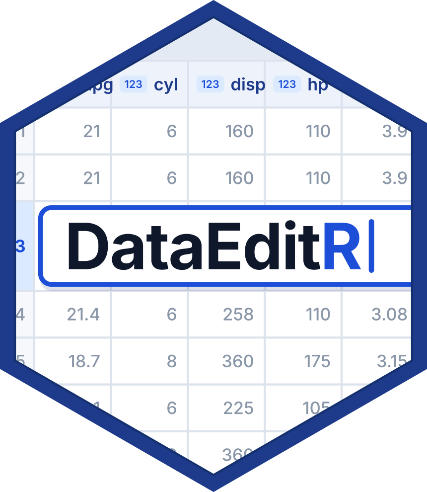
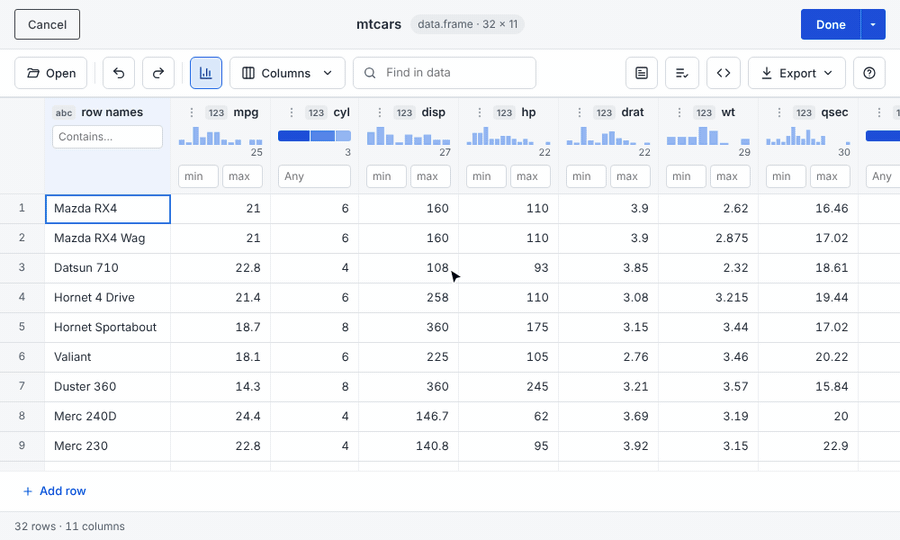

<!-- README.md is generated from README.Rmd. Please edit that file -->

# DataEditR 

<!-- badges: start -->

[](https://www.repostatus.org/#active)
[](https://lifecycle.r-lib.org/articles/stages.html)
[](https://github.com/DillonHammill/DataEditR/actions?workflow=R-CMD-check)
[](https://CRAN.R-project.org/package=DataEditR)
[](https://cran.r-project.org/package=DataEditR)
<!-- badges: end -->

Manual data entry and editing in R can be tedious, especially if you
have limited coding experience and are accustomed to using software with
a Graphical User Interface (GUI). **DataEditR** is an R package built on
shiny and the MIT-licensed [Tabulator](https://tabulator.info)
JavaScript library that makes it easy to interactively view, enter,
filter and edit data, including tables stored in databases. If you are
new to **DataEditR** visit <https://dillonhammill.github.io/DataEditR/>
to get started.

## Installation

**DataEditR** can be installed from CRAN:

``` r
install.packages("DataEditR")
```

The development version of **DataEditR** can be installed directly from
GitHub:

``` r
library(devtools)
install_github("DillonHammill/DataEditR")
```

## Usage

Supply your data to `data_edit()` to open it in the data editor, make
your changes and press `Done` to get the edited data back. The animation
below edits cells, fills down a selection, adds a row, renames a column,
filters rows, hides columns, finds values, undoes and redoes, reviews
and reverts changes, shows the code that reproduces the edits and
returns or saves the data from the `Done` menu:

``` r
library(DataEditR)

# Edit mtcars, save the result to an R object and a csv file
mtcars_new <- data_edit(mtcars,
                        save_as = "mtcars_new.csv")
```



`data_edit()` works with data frames, matrices, tibbles, data.tables,
files (read with any reading function) and database tables, and can
create new tables from scratch. It is also available from the RStudio
`Addins` menu as *Interactive Data Editor*. The editor is built from
shiny modules, so you can add it to your own shiny applications with
`dataEditUI()` and `dataEditServer()`, save the changes (including to
databases) with `dataEditCommit()` and count unsaved changes with
`dataEditChanges()`. `data_code()` generates tidyverse-style code that
reproduces your edits.

#### General features:

- RStudio add-in: highlight the name of a dataset and open it in the
  editor
- flexible display options (either `dialog` box, `browser` or RStudio
  `viewer` pane)
- fast, even with large data: only the visible rows are drawn and edits
  are sent to R cell by cell
- edit tables in a database directly (`dplyr::tbl()` or `db_table()`),
  with changes written in a single transaction after you confirm them
- tables bigger than memory: rows are loaded on demand, filtered and
  sorted by the database
- ability to interactively create data.frames from scratch
- load tabular data saved to file using any reading function
  (e.g. `read.csv()`)
- open other R objects, files or a new table without leaving the editor
- save edited data to file using any writing function
  (e.g. `write.csv()`), or export all data or only what is on screen
- return appropriately formatted data as an R object for downstream use,
  keeping column types and the class of the data
- review panel listing every change with one-click revert, and live
  tidyverse-style code that reproduces your edits (`data_code()`)
- a summary under each column name (histogram or most common values,
  missing values, distinct values) whose bars filter the rows
- a form to enter or check data one record at a time
- SPSS, Stata and SAS files and labelled data: values are shown and
  entered by their labels, and variable labels, value labels and missing
  values are kept
- formulas, find and replace, recoding, type changes and sorting for
  whole columns, each shown in the generated code as one `dplyr` verb
- validation rules (required, unique, limits, patterns or any formula),
  with problem cells marked and listed before you press `Done`
- a history of every change with who made it and when, notes saying why,
  and a change log kept in a file (`log`)
- unsaved changes are kept as a draft and offered again if the editor is
  closed or R crashes
- support for custom themes through the `bslib` package
- customisable user interface (title, logo, menus)
- shiny modules to use the data editor in your own applications, with
  `dataEditCommit()` to save changes (including to databases),
  `dataEditChanges()` to count unsaved changes, `dataEditProblems()` for
  broken rules and `dataEditLog()` for the change log

#### Data editing features:

- undo and redo (`Ctrl+Z` / `Ctrl+Y`)
- edit cells, row names and column names
- add or remove rows and columns from the context menus
- range selection, copy and paste to and from spreadsheets (Excel,
  Google Sheets, LibreOffice), with rows added as needed and formatted
  numbers and dates converted, fill down (`Ctrl+D`) and clearing of
  selected cells
- filter rows by typing under the column headers (ranges, value lists,
  text)
- show or hide columns from the `Columns` menu
- find values in the data (`Ctrl+F`)
- status bar with row/column counts and a sum/mean/count of the selected
  cells
- asks before a typed value would turn a number or date column into text
- edits to filtered data are applied directly to the complete dataset
- change tracking to visually highlight edited and added cells (`track`)
- column types to simplify user input: checkboxes, dropdown menus,
  dates, date-times, times, text over several lines, passwords, web
  addresses, colours, numbers within limits, sliders and star ratings
- read-only and hidden columns
- support for factor columns: edited as text and returned as factors
  with their levels
- control over which rows, columns and column names can be edited
- manual column resizing and stretching columns to fill the available
  space
- programmatically add columns or rows to data prior to loading into the
  data editor

Visit <https://dillonhammill.github.io/DataEditR/> for the user guide
and articles on editing database tables and using **DataEditR** in shiny
applications.

## Credits

**DataEditR** is built using the fantastic
[Tabulator](https://tabulator.info) JavaScript library by Oli Folkerd
(MIT licence). Earlier versions of **DataEditR** were built on the
[rhandsontable](https://github.com/jrowen/rhandsontable) package. The
user interface of **DataEditR** has been inspired by the
[editData](https://github.com/cardiomoon/editData) package which is a
great alternative to **DataEditR**.

## Licence

**DataEditR** is released under the GPL-2 licence. It bundles the
[Tabulator](https://tabulator.info) JavaScript library (MIT licence) and
icons based on [Lucide](https://lucide.dev) (ISC licence); see the
[COPYRIGHTS](https://github.com/DillonHammill/DataEditR/blob/master/inst/COPYRIGHTS)
file for their copyright notices.

## Code of Conduct

Please note that the **DataEditR** project is released with a
[Contributor Code of
Conduct](https://contributor-covenant.org/version/2/0/CODE_OF_CONDUCT.html).
By contributing to this project, you agree to abide by its terms.

## Citation

If you use **DataEditR** in your work, please cite the package as
follows:

``` r
citation("DataEditR")
#> To cite package 'DataEditR' in publications use:
#> 
#>   Hammill D (2026). _DataEditR: An Interactive Editor for Viewing,
#>   Entering, Filtering & Editing Data_. R package version 2.0.0,
#>   <https://dillonhammill.github.io/DataEditR/>.
#> 
#> A BibTeX entry for LaTeX users is
#> 
#>   @Manual{,
#>     title = {DataEditR: An Interactive Editor for Viewing, Entering, Filtering & Editing Data},
#>     author = {Dillon Hammill},
#>     year = {2026},
#>     note = {R package version 2.0.0},
#>     url = {https://dillonhammill.github.io/DataEditR/},
#>   }
```
